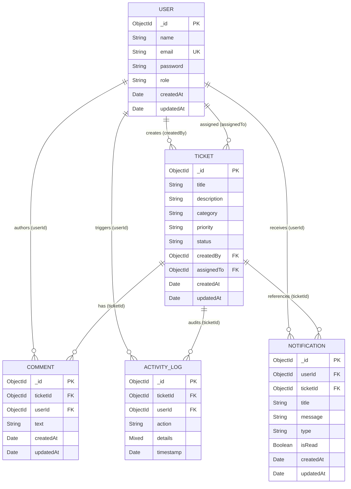

# Database Design Explanation

The application uses **MongoDB** via **Mongoose ODM**, organized around five cohesive collections that model users, support tickets, discussions, event audit trails, and notifications.

---

## Entity-Relationship Diagram

---

## Collection Schemas & Design Decisions

### 1. `users` (`backend/models/User.js`)
- **Fields:** `name`, `email` (unique, lowercase), `password` (bcrypt hashed via pre-save hook, `select: false` so hashes are never leaked in queries), `role` (`'user'` | `'admin'`, defaults to `'user'`), `createdAt`, `updatedAt`.
- **Rationale:** Setting `select: false` on `password` and stripping it in `toJSON()` enforces defense-in-depth data protection.

### 2. `tickets` (`backend/models/Ticket.js`)
- **Fields:** `title` (5–200 chars), `description` (10–5000 chars), `category` (`General`, `Bug`, `Feature`, `Account`), `priority` (`Low`, `Medium`, `High`, `Urgent`), `status` (`Open`, `In Progress`, `Resolved`, `Closed`), `createdBy` (ref `User`), `assignedTo` (ref `User`, nullable), `timestamps`.
- **Indexes:**
  - `{ title: 'text', description: 'text' }` for full-text search readiness.
  - `{ status: 1 }`, `{ priority: 1 }`, `{ category: 1 }` for fast admin filtering and aggregation pipelines.
  - `{ createdBy: 1, createdAt: -1 }` compound index so user ticket pages fetch & sort in a single index scan.
  - `{ createdAt: -1 }` for default chronological sorting across admin queues.

### 3. `comments` (`backend/models/Comment.js`)
- **Fields:** `ticketId` (ref `Ticket`), `userId` (ref `User`), `text` (1–2000 chars), `timestamps`.
- **Indexes:** `{ ticketId: 1, createdAt: 1 }` for chronological conversation retrieval.
- **Rationale:** Storing comments in a separate collection rather than embedding an unbounded array inside `Ticket` avoids MongoDB's 16MB document limit on active long-lived tickets and simplifies pagination/author population.

### 4. `activitylogs` (`backend/models/ActivityLog.js`)
- **Fields:** `ticketId` (ref `Ticket`), `userId` (ref `User`), `action` (`ticket.created`, `ticket.updated`, `status.changed`, `comment.added`, `ticket.resolved`, `ticket.deleted`), `details` (`Mixed` metadata object such as `{ from, to }` or `{ updatedFields }`), `timestamp`.
- **Indexes:** `{ ticketId: 1, timestamp: -1 }`, `{ userId: 1 }`, `{ action: 1 }`.
- **Rationale:** Event-driven audit logs remain append-only and preserve context (`details.title`, `details.from`, `details.to`) even after a ticket is modified or deleted.

### 5. `notifications` (`backend/models/Notification.js`)
- **Fields:** `userId` (ref `User`), `ticketId` (ref `Ticket`, nullable), `title`, `message`, `type`, `isRead` (Boolean, default `false`), `timestamps`.
- **Indexes:** `{ userId: 1, isRead: 1, createdAt: -1 }` for fast unread count queries and notification bell dropdown retrieval.
